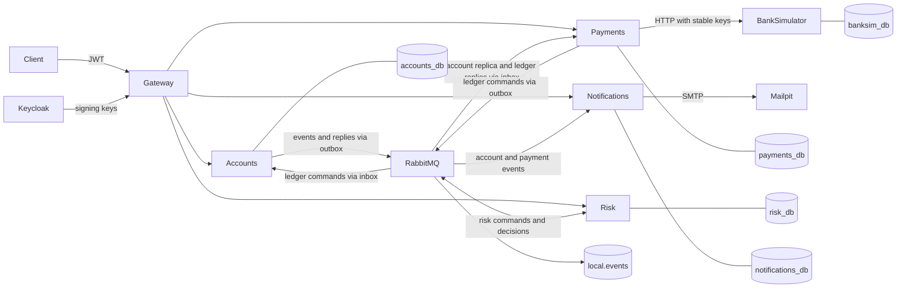
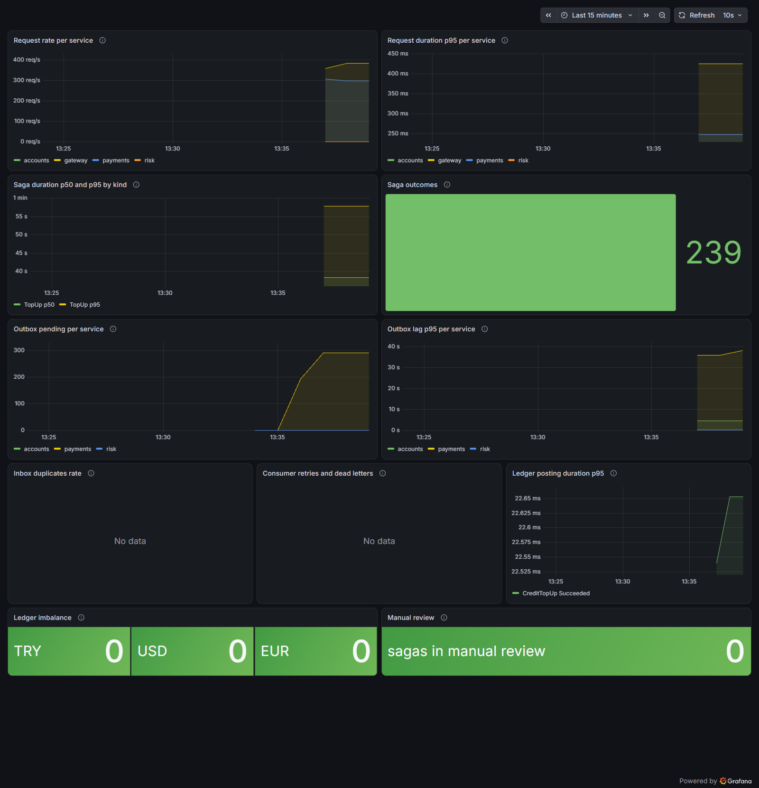
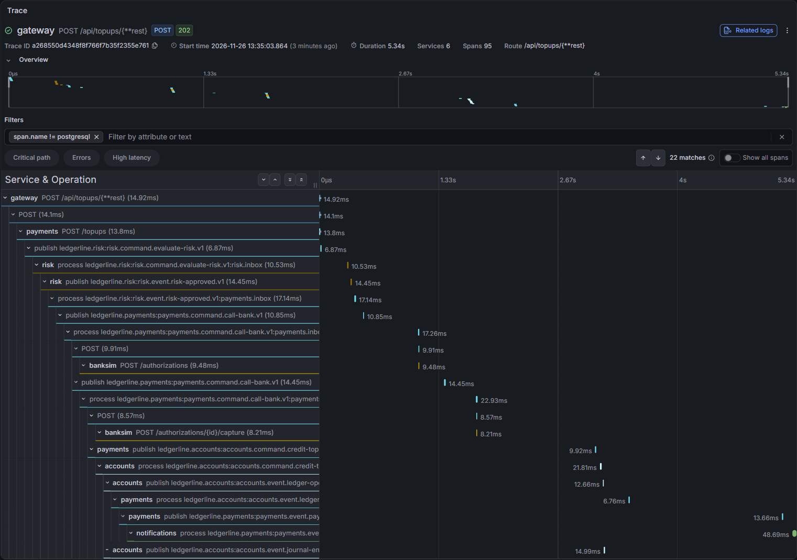

# Ledgerline

[](https://github.com/kubicix/ledgerline/actions/workflows/ci.yml)
[](https://github.com/kubicix/ledgerline/actions/workflows/codeql.yml)

A payment and wallet backend built as .NET 10 microservices. An event-sourced
double-entry ledger, payment sagas with bank compensation, Risk and email services
communicate through RabbitMQ with a transactional outbox and inbox.

> **What this is and is not.** A portfolio project that demonstrates concepts:
> idempotency, double-entry bookkeeping, sagas, reconciliation. It moves no real
> money, talks to a fake bank that lives in this repository, is not PCI DSS
> compliant, and is not banking experience. At this size I would build it as a
> modular monolith; see [When would I build this as a monolith?](docs/when-monolith.md)

## Status

| Milestone | Scope | State |
|---|---|---|
| Design | Design, specs, ADRs, plan, walking skeleton | Done |
| M1 | Accounts and Ledger, Payments, RabbitMQ, outbox and inbox, one command | Implemented and locally verified |
| M2 | Sagas with compensation, Risk, Notifications, gateway, auth | Implemented, reviewed, 505 tests passing; [integration record](https://github.com/kubicix/ledgerline/pull/2) |
| M3 | Failure-scenario tests, k6, OpenTelemetry dashboards, CI security scans | Implemented and reviewed on branch `milestone-3`; not yet merged or pushed |
| M4 | Kubernetes with Helm and health checks | Implemented and reviewed on branch `milestone-4`; not yet merged or pushed |
| M5 | Kafka event stream, MongoDB read model, reconciliation job | Not started |
| M6 | Blazor UI | Not started |

Accounts, Payments, Risk, Notifications, BankSimulator and Gateway run together.
Redis supports idempotency and Risk velocity windows; Keycloak issues JWTs.
Telemetry dashboards, Kubernetes, reporting, reconciliation and the UI belong to
later milestones. See [progress and agent handoff](docs/progress.md).

## Quick start

Requirements: Docker with Compose v2 or later. The Bash smoke script uses curl and
standard shell utilities; Windows users can use the PowerShell script instead.
The .NET 10 SDK is needed only to build or test from source.

```bash
docker compose --profile app up --build -d --wait
./scripts/smoke.sh
# SMOKE OK: alice=6000 bob=2500 shop=1500 trial=0 emails>=4

docker compose --profile app down
```

PowerShell: run the same Compose command, then `./scripts/smoke.ps1`, and the same
shutdown command. Both scripts use seeded synthetic users, open customer and merchant
wallets, top up 10,000 minor units, transfer 2,500, authorize a merchant payment,
capture 2,000 and refund 500. They verify balances, zero trial balance and Mailpit
delivery. Local data survives
`down`. To run infrastructure alone, use `docker compose up -d`.
Mailpit uses a persistent local database volume so a restart preserves the email
evidence used by repeated smoke runs.

For a complete first M2 verification, stop an earlier demo stack and use a fresh
project, for example `docker compose -p ledgerline-m2-demo --profile app up --build -d --wait`.
This preserves the earlier project's volumes and exercises new flows rather than
replaying earlier milestone resources. Use the same `-p ledgerline-m2-demo` on
subsequent Compose commands for that demo.

Compose runs migration jobs before starting each application. Applications run as
non-root users and expose anonymous `/health/live` and `/health/ready` endpoints;
readiness checks their own database and RabbitMQ connection.

APIs validate Keycloak JWT bearer tokens with the `ledgerline-api` audience. POST
requests require `Idempotency-Key`. The local realm seeds `alice` and `bob` as
customers, `shop` as merchant, and `admin`; development passwords are `<name>_dev`.
It also seeds the k6 load users `load-customer-001` to `load-customer-200` and
`load-merchant-01` to `load-merchant-10`, with the same `<username>_dev` pattern.
Smoke scripts obtain tokens through the development-only `ledgerline-k6` client and
reuse stable idempotency keys so retained demo data can be checked repeatedly.

| What | URL | Credentials (local development only) |
|---|---|---|
| API gateway | http://localhost:8080/api | Keycloak tokens; service ports are internal |
| Keycloak | http://localhost:8081 | `admin` / `ledgerline_dev` |
| RabbitMQ management | http://localhost:15672 | `ledgerline` / `ledgerline_dev` |
| Grafana | http://localhost:3000 | anonymous |
| Mailpit | http://localhost:8025 | none |

Build and test from source:

```bash
dotnet build Ledgerline.slnx
dotnet test --solution Ledgerline.slnx --max-parallel-test-modules 1
```

## Architecture



The Compose `rabbitmq-init` job declares `local.events`, a durable quorum queue
bound to journal-entry-posted, payment-completed and payment-failed events. It retains
events whose business consumers arrive in later milestones, so mandatory publication
can complete. It does not
consume commands or replay events to future services. The queue retains local demo
history; it is not a production retention policy.

Account replication and ledger replies retain their normal mandatory routing: if
the required consumer has not started yet, the event stays in the outbox for retry.

Short version:

- **Accounts and Ledger** is the only writer of money. Append-only event store,
  double-entry journal, balances as projections.
- **Payments** orchestrates top-up, transfer, merchant authorization/capture/void,
  refunds and bank compensation. Broker outages do not consume unpublished attempts.
- **Risk** evaluates limits with database serialization and Redis velocity windows.
- **Notifications** consumes events independently of SMTP and retries failed delivery.
- Services own their databases and talk only through RabbitMQ. Every outgoing message
  goes through a transactional outbox; every consumer deduplicates through an inbox.
- **Gateway** (YARP) validates Keycloak tokens, enforces route policies and rate
  limits, and forwards correlation and idempotency headers. APIs validate tokens again.

Full design: [docs/design.md](docs/design.md). Per-service specs: [docs/specs](docs/specs).
Payment flows: [docs/specs/payments.md](docs/specs/payments.md).

## Decisions

| ADR | Decision |
|---|---|
| [0000](docs/adr/0000-verified-versions.md) | Versions and licenses, verified against official sources |
| [0001](docs/adr/0001-microservices-vs-modular-monolith.md) | Microservices here, knowing a modular monolith fits better |
| [0002](docs/adr/0002-messaging-library.md) | Raw RabbitMQ client, no bus library |
| [0003](docs/adr/0003-outbox-inbox.md) | Transactional outbox with a polling relay, inbox table |
| [0004](docs/adr/0004-identity-provider.md) | Keycloak |
| [0005](docs/adr/0005-compose-vs-aspire.md) | Docker Compose as the one command |
| [0006](docs/adr/0006-saga-orchestration.md) | Orchestrated saga, hand-written state machine |
| [0007](docs/adr/0007-event-sourcing-scope.md) | Event sourcing for the ledger only |
| [0008](docs/adr/0008-test-strategy.md) | Test strategy |
| [0009](docs/adr/0009-observability.md) | OpenTelemetry to Grafana LGTM |
| [0010](docs/adr/0010-scheduler.md) | Quartz.NET for reconciliation |
| [0011](docs/adr/0011-kubernetes-packaging.md) | kind, one Helm chart, dev-grade infrastructure |

## Failure scenarios

Each scenario has deterministic integration tests that run on every push. The first
three also have a system test that kills real containers; system tests run on `main`
and nightly, and locally with `LEDGERLINE_SYSTEM_TESTS=1`. Tests that move money end
with the ledger invariant check (trial balance zero in every currency). Steps and assertions
per test: [docs/testing.md](docs/testing.md).

| Scenario | Test | Level | File |
|---|---|---|---|
| Broker down: outbox keeps messages and delivers once after recovery | `Outbox_keeps_messages_while_broker_is_down_and_delivers_after_recovery` | integration | [FailureScenarioTests.cs](tests/Ledgerline.BuildingBlocks.Messaging.IntegrationTests/FailureScenarioTests.cs) |
| Broker down: top-ups accepted during the outage complete afterwards | `Topups_accepted_during_broker_outage_complete_after_recovery` | integration | [TimeoutTests.cs](tests/Ledgerline.Payments.IntegrationTests/TimeoutTests.cs) |
| Broker down: RabbitMQ stopped under 50 top-ups and 50 transfers | `Broker_outage_loses_no_money` | system | [FailureSystemTests.cs](tests/Ledgerline.SystemTests/FailureSystemTests.cs) |
| Crash after ledger commit, before ack | `Crash_after_ledger_commit_before_ack_does_not_double_post` | integration | [CrashTests.cs](tests/Ledgerline.Accounts.IntegrationTests/CrashTests.cs) |
| Crash after saga transition commit | `Crash_after_saga_transition_commit_resumes_from_outbox` | integration | [CrashTests.cs](tests/Ledgerline.Payments.IntegrationTests/CrashTests.cs) |
| Crash after bank capture, before commit | `Crash_after_bank_capture_before_commit_does_not_capture_twice` | integration | [BankCallTests.cs](tests/Ledgerline.Payments.IntegrationTests/BankCallTests.cs) |
| Crash after publish, before the outbox row is marked processed | `Crash_after_publish_before_marking_processed_republishes_and_consumer_deduplicates` | integration | [FailureScenarioTests.cs](tests/Ledgerline.BuildingBlocks.Messaging.IntegrationTests/FailureScenarioTests.cs) |
| Payments killed with 100 top-ups in flight | `Killing_payments_mid_saga_completes_after_restart` | system | [FailureSystemTests.cs](tests/Ledgerline.SystemTests/FailureSystemTests.cs) |
| Accounts killed during 200 transfers | `Killing_accounts_mid_posting_completes_after_restart` | system | [FailureSystemTests.cs](tests/Ledgerline.SystemTests/FailureSystemTests.cs) |
| Same message delivered twice | `Same_message_delivered_twice_is_handled_once` | integration | [ConsumerTests.cs](tests/Ledgerline.BuildingBlocks.Messaging.IntegrationTests/ConsumerTests.cs) |
| Same message delivered to two consumers at once | `Same_message_delivered_concurrently_to_two_consumers_is_handled_once` | integration | [ConsumerTests.cs](tests/Ledgerline.BuildingBlocks.Messaging.IntegrationTests/ConsumerTests.cs) |
| Same operation with a new message id | `Same_operation_with_new_message_id_returns_same_reply_without_second_entry` | integration | [LedgerCommandTests.cs](tests/Ledgerline.Accounts.IntegrationTests/LedgerCommandTests.cs) |
| Duplicate and late saga replies | `Duplicate_and_late_replies_do_not_move_a_final_payment` | integration | [TransferFlowTests.cs](tests/Ledgerline.Payments.IntegrationTests/TransferFlowTests.cs) |
| Every message replayed during a mixed workload | `Replaying_every_message_changes_nothing` | system | [ReplaySystemTests.cs](tests/Ledgerline.SystemTests/ReplaySystemTests.cs) |
| 50 concurrent debits on one account | `Concurrent_debits_never_overdraw` | integration | [ConcurrencyTests.cs](tests/Ledgerline.Accounts.IntegrationTests/ConcurrencyTests.cs) |
| Opposite-direction transfers | `Opposite_direction_transfers_do_not_deadlock` | integration | [ConcurrencyTests.cs](tests/Ledgerline.Accounts.IntegrationTests/ConcurrencyTests.cs) |
| Concurrent capture and void of one payment | `Capture_and_void_race_has_exactly_one_winner` | integration | [MerchantPaymentFlowTests.cs](tests/Ledgerline.Payments.IntegrationTests/MerchantPaymentFlowTests.cs) |
| Same idempotency key sent concurrently | `Same_idempotency_key_sent_concurrently_creates_one_payment` | integration | [PaymentsApiTests.cs](tests/Ledgerline.Payments.IntegrationTests/PaymentsApiTests.cs) |
| Poison message | `Poison_message_goes_to_dead_queue_after_max_attempts` | integration | [RetryAndDeadLetterTests.cs](tests/Ledgerline.BuildingBlocks.Messaging.IntegrationTests/RetryAndDeadLetterTests.cs) |
| Bank times out after succeeding | `Bank_timeout_with_success_is_resolved_by_lookup` | integration | [BankCallTests.cs](tests/Ledgerline.Payments.IntegrationTests/BankCallTests.cs) |
| Ledger rejects after the bank captured | `Ledger_rejection_after_bank_capture_refunds_at_bank` | integration | [TopUpFlowTests.cs](tests/Ledgerline.Payments.IntegrationTests/TopUpFlowTests.cs) |
| Compensation exhausted | `Exhausted_compensation_ends_in_manual_review` | integration | [TopUpFlowTests.cs](tests/Ledgerline.Payments.IntegrationTests/TopUpFlowTests.cs) |

The table lists the main tests per scenario; the full list is in
[docs/testing.md](docs/testing.md). Load results, including the misses, are under
[Measurements](#measurements).

## Measurements

Seven k6 scenarios ran through the gateway against the Compose stack on one desktop PC:
AMD Ryzen 5 7500F (6 cores, 12 threads), 32 GB RAM, a DRAM-less 1 TB NVMe, Docker Desktop
on WSL2 with its defaults (12 CPUs, 15.5 GiB), one replica of every service, the scripts of commit
`d165fea`. The load generator ran on the same machine, so **these are not capacity
numbers**. Hardware, method, per-threshold tables and every miss are in
[docs/results/k6-2026-11-26.md](docs/results/k6-2026-11-26.md).

| Scenario | Load | p95 accept | p95 saga completion | Errors | Target met |
|---|---|---|---|---|---|
| Smoke | 5 users, 60 s | 30.31 ms | top-up 1.57 s, transfer 0.97 s | 0 % | Yes in 1 of 4 runs (see results) |
| Transfers, steady | 100/s offered, 13.5/s sent (k6 VU ceiling) | 252.12 ms | 30 s timeout (server side 174.9 s) | 0 % | No |
| Top-ups, steady | 50/s offered, 10.1/s sent (k6 VU ceiling) | 359.44 ms | 30 s timeout (server side 196.2 s) | 0 % | No |
| Hot account | 100/s offered, 13.5/s sent (k6 VU ceiling) | 467.57 ms | 30 s timeout (server side 218 s) | 0 % | No |
| Payment mix | 50/s offered, 13.3/s sent (k6 VU ceiling) | 624.90 ms | 30 s timeout | 0 % | No |
| Spike | 20 to 300/s | 233.43 ms | 120 s probe timeout | 0 % | No |
| Broker outage | 50/s, RabbitMQ stopped 30 s, all accepted | 119.7 ms | 150 s probe timeout; recovery at least 148 s against 60 s | 0 % | Acceptance yes, recovery no |

What held in every run: no lost or duplicated money (trial balance 0 in every currency),
no payment in `ManualReview`, every outbox row relayed, and every accepted
payment reached a final state once the backlog drained. What missed: latency and
throughput. The stack completed about 2 to 6 sagas per second during the load, and k6 could send only
10 to 13.5 per second of the 50 to 100 offered because every VU was waiting on a slow
saga. Three measured reasons: the disk behind Docker Desktop stalls for about 17 s every
55 to 90 s under the fsync load of commits and broker confirms; the outbox relay
publishes and confirms one message at a time, so Payments' outbox lag p95 reached 61 to
96 s; and k6's 100 ms status polling (about 1 300 to 2 000 requests per second) ran on
the same CPU. The same transfer as one local transaction, without the broker, ran at 472
to 1 032 per second with a p95 of 23.72 to 67.09 ms. The hot-account result and the
decision not to shard are in [ADR 0007](docs/adr/0007-event-sourcing-scope.md).

The provisioned Grafana dashboard during the top-up load run. Panels hold only about the first
40 s of the load because the OpenTelemetry collector in the dev telemetry container
ran out of memory (see the results page):



One top-up traced from the HTTP request through the outbox and RabbitMQ across six
services (gateway, Payments, Risk, BankSimulator, Accounts, Notifications); database
spans are filtered out:



## Run on Kubernetes

The same system runs on a local [kind](https://kind.sigs.k8s.io/) cluster, packaged as one umbrella Helm chart
(`deploy/helm/ledgerline`). You need Docker, kind, Helm 4 and kubectl (install steps in
[docs/kubernetes.md](docs/kubernetes.md)). Stop the Compose stack first: both use host ports 8080, 8081, 3000 and 8025.

```bash
./scripts/kind-up.sh                       # create the cluster "ledgerline"
./scripts/kind-deploy.sh                   # build and load the images, install the chart, wait until ready
./scripts/smoke.sh http://localhost:8080   # the same smoke flow as on Compose
```

PowerShell has twins for each script: `kind-up.ps1`, `kind-deploy.ps1`, `smoke.ps1` and `kind-down.ps1`. The
resilience proof is `./scripts/kind-resilience.sh`: it deletes Payments and Accounts pods and then does a rolling
restart of Payments during a k6 workload, and it passes only when no payment is stuck and the trial balance is zero.
The `kind` job in [ci.yml](.github/workflows/ci.yml) runs the deploy, the smoke flow and the resilience proof on every
push to `main`.

Every service has the same three probes, rendered from one template:

| Probe | Endpoint | Settings | Meaning |
|---|---|---|---|
| Startup | `GET /health/live` | every 2 s, 30 failures allowed | Gives a slow first start up to 60 s before liveness begins |
| Liveness | `GET /health/live` | every 10 s, 3 failures | The process answers; it never checks a dependency |
| Readiness | `GET /health/ready` | every 5 s, 3 failures | Accounts, Payments, Risk, Notifications: the service's own database and the RabbitMQ connection. BankSimulator: its own database only. Gateway: Keycloak signing keys fetched once. Never another service |

On shutdown a pod sleeps 5 s in a `preStop` hook, so the endpoint lists catch up, and reports `503` on `/health/ready`
from the start of the shutdown. It then finishes the messages in flight within a termination grace period of 30 s.
Migrations are not run by the services: a Helm hook Job per database runs the service image's `migrate` command, and a
first install runs in two passes so that PostgreSQL exists before the first migration (explained in
[docs/kubernetes.md](docs/kubernetes.md)).

The infrastructure is dev-grade on purpose (ADR 0011). Limits:

- One single-node kind cluster, one replica of PostgreSQL, RabbitMQ, Redis, Keycloak and the telemetry container: no
  high availability, no operators.
- Only PostgreSQL and RabbitMQ keep their data on a volume. Redis, Mailpit and the telemetry data are in `emptyDir`
  volumes and are lost when their pod is replaced; telemetry is disposable.
- Credentials are dev values committed in `values.yaml` and rendered as plain Kubernetes Secrets. A real deployment
  would use an external secret store.
- No ingress controller and no TLS. The gateway is a NodePort mapped to `localhost:8080`, and it stays the only public
  entry for the API. Keycloak runs in dev mode on `localhost:8081`.
- The application images are tagged `:local` and loaded into the node, not pulled from a registry.

The production path is managed or operator-run databases and brokers, an external secret store and an ingress with
TLS; the reasoning is in [ADR 0011](docs/adr/0011-kubernetes-packaging.md). Details of the cluster, the two-pass deploy
and the resilience checks are in [docs/kubernetes.md](docs/kubernetes.md).

## Phase 2: event stream, read model, reconciliation

_Placeholder: filled in M5-T11._

## Demo UI

_Placeholder: filled in M6-T06._

## Security scans in CI

The `security` and `images` jobs in [ci.yml](.github/workflows/ci.yml) and the
[codeql.yml](.github/workflows/codeql.yml) workflow run these scans:

| Scan | Covers | Runs |
|---|---|---|
| Dependency review (`actions/dependency-review-action`) | Dependencies added or changed in a pull request: known vulnerabilities and licenses | Pull requests |
| Vulnerable NuGet packages (`dotnet list package --vulnerable --include-transitive`) | Direct and transitive packages of the whole solution; any hit fails the job | Push to `main`, pull requests, nightly |
| Secret scan (gitleaks, [.gitleaks.toml](.gitleaks.toml)) | Committed secrets: the pull request's commits on pull requests, the pushed commits on push, the full git history on the nightly run | Push to `main`, pull requests, nightly |
| Static analysis (CodeQL, C#) | Code-level vulnerabilities in the source, using a manual build | Push to `main`, pull requests |
| Image scan (Trivy) | Fixed HIGH and CRITICAL vulnerabilities in the six service images | Push to `main` |

On a private repository, dependency review and the CodeQL result upload need GitHub
Advanced Security. The scans are meant to run unchanged once the repository is public.

## When would I build this as a monolith?

Almost always, at this size. The reasoning, the cost table, and the order in which I
would split a monolith are in [docs/when-monolith.md](docs/when-monolith.md).

## What I would do differently in production

_Placeholder: filled as milestones complete. Known items so far:_

- Use a maintained messaging library instead of a hand-rolled layer (ADR 0002).
- Separate database instances per service, managed or run by operators (ADR 0011).
- A hardened identity provider setup instead of Keycloak dev mode (ADR 0004).
- An external secret store.
- Distributed rate limiting at the gateway.

## Repository layout

```
docs/         design, specs, ADRs, testing, plan
src/          BuildingBlocks, Contracts, Services, Gateway
tests/        unit, integration, architecture, system tests; k6 scripts (M3)
deploy/       Compose support files; Helm chart (M4)
```

## Implementation plan

[docs/plan.md](docs/plan.md): six milestones, small test-first tasks, each with the
command that proves it is done.

## License

_Placeholder: to be chosen by the owner before the repository is made public._
