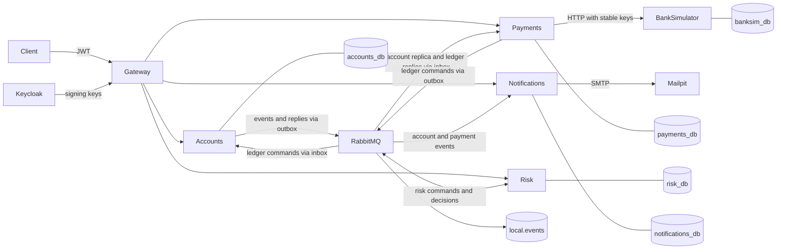

# Ledgerline

A payment and wallet backend built as .NET 10 microservices. An event-sourced
double-entry ledger, payment sagas with bank compensation, Risk and email services
communicate through RabbitMQ with a transactional outbox and inbox.

> **What this is and is not.** A portfolio project that demonstrates concepts:
> idempotency, double-entry bookkeeping, sagas, reconciliation. It moves no real
> money, talks to a fake bank that lives in this repository, is not PCI DSS
> compliant, and is not banking experience. At this size I would build it as a
> modular monolith; see [When would I build this as a monolith?](docs/when-monolith.md)

## Status

| Milestone | Scope | State |
|---|---|---|
| Design | Design, specs, ADRs, plan, walking skeleton | Done |
| M1 | Accounts and Ledger, Payments, RabbitMQ, outbox and inbox, one command | Implemented and locally verified |
| M2 | Sagas with compensation, Risk, Notifications, gateway, auth | Implementation complete; final verification and review in progress |
| M3 | Failure-scenario tests, k6, OpenTelemetry dashboards, CI security scans | Not started |
| M4 | Kubernetes with Helm and health checks | Not started |
| M5 | Kafka event stream, MongoDB read model, reconciliation job | Not started |
| M6 | Blazor UI | Not started |

Accounts, Payments, Risk, Notifications, BankSimulator and Gateway run together.
Redis supports idempotency and Risk velocity windows; Keycloak issues JWTs.
Telemetry dashboards, Kubernetes, reporting, reconciliation and the UI belong to
later milestones. See [progress and agent handoff](docs/progress.md).

## Quick start

Requirements: Docker with Compose v2 or later. The Bash smoke script uses curl and
standard shell utilities; Windows users can use the PowerShell script instead.
The .NET 10 SDK is needed only to build or test from source.

```bash
docker compose --profile app up --build -d --wait
./scripts/smoke.sh
# SMOKE OK: alice=6000 bob=2500 shop=1500 trial=0 emails>=4

docker compose --profile app down
```

PowerShell: run the same Compose command, then `./scripts/smoke.ps1`, and the same
shutdown command. Both scripts use seeded synthetic users, open customer and merchant
wallets, top up 10,000 minor units, transfer 2,500, authorize a merchant payment,
capture 2,000 and refund 500. They verify balances, zero trial balance and Mailpit
delivery. Local data survives
`down`. To run infrastructure alone, use `docker compose up -d`.

Compose runs migration jobs before starting each application. Applications run as
non-root users and expose anonymous `/health/live` and `/health/ready` endpoints;
readiness checks their own database and RabbitMQ connection.

APIs validate Keycloak JWT bearer tokens with the `ledgerline-api` audience. POST
requests require `Idempotency-Key`. The local realm seeds `alice` and `bob` as
customers, `shop` as merchant, and `admin`; development passwords are `<name>_dev`.
Smoke scripts obtain tokens through the development-only `ledgerline-k6` client and
reuse stable idempotency keys so retained demo data can be checked repeatedly.

| What | URL | Credentials (local development only) |
|---|---|---|
| API gateway | http://localhost:8080/api | Keycloak tokens; service ports are internal |
| Keycloak | http://localhost:8081 | `admin` / `ledgerline_dev` |
| RabbitMQ management | http://localhost:15672 | `ledgerline` / `ledgerline_dev` |
| Grafana | http://localhost:3000 | anonymous |
| Mailpit | http://localhost:8025 | none |

Build and test from source:

```bash
dotnet build Ledgerline.slnx
dotnet test --solution Ledgerline.slnx --max-parallel-test-modules 1
```

## Architecture



The Compose `rabbitmq-init` job declares `local.events`, a durable quorum queue
bound to journal-entry-posted, payment-completed and payment-failed events. It retains
events whose business consumers arrive in later milestones, so mandatory publication
can complete. It does not
consume commands or replay events to future services. The queue retains local demo
history; it is not a production retention policy.

Account replication and ledger replies retain their normal mandatory routing: if
the required consumer has not started yet, the event stays in the outbox for retry.

Short version:

- **Accounts and Ledger** is the only writer of money. Append-only event store,
  double-entry journal, balances as projections.
- **Payments** orchestrates top-up, transfer, merchant authorization/capture/void,
  refunds and bank compensation. Broker outages do not consume unpublished attempts.
- **Risk** evaluates limits with database serialization and Redis velocity windows.
- **Notifications** consumes events independently of SMTP and retries failed delivery.
- Services own their databases and talk only through RabbitMQ. Every outgoing message
  goes through a transactional outbox; every consumer deduplicates through an inbox.
- **Gateway** (YARP) validates Keycloak tokens, enforces route policies and rate
  limits, and forwards correlation and idempotency headers. APIs validate tokens again.

Full design: [docs/design.md](docs/design.md). Per-service specs: [docs/specs](docs/specs).
Payment flows: [docs/specs/payments.md](docs/specs/payments.md).

## Decisions

| ADR | Decision |
|---|---|
| [0000](docs/adr/0000-verified-versions.md) | Versions and licenses, verified against official sources |
| [0001](docs/adr/0001-microservices-vs-modular-monolith.md) | Microservices here, knowing a modular monolith fits better |
| [0002](docs/adr/0002-messaging-library.md) | Raw RabbitMQ client, no bus library |
| [0003](docs/adr/0003-outbox-inbox.md) | Transactional outbox with a polling relay, inbox table |
| [0004](docs/adr/0004-identity-provider.md) | Keycloak |
| [0005](docs/adr/0005-compose-vs-aspire.md) | Docker Compose as the one command |
| [0006](docs/adr/0006-saga-orchestration.md) | Orchestrated saga, hand-written state machine |
| [0007](docs/adr/0007-event-sourcing-scope.md) | Event sourcing for the ledger only |
| [0008](docs/adr/0008-test-strategy.md) | Test strategy |
| [0009](docs/adr/0009-observability.md) | OpenTelemetry to Grafana LGTM |
| [0010](docs/adr/0010-scheduler.md) | Quartz.NET for reconciliation |
| [0011](docs/adr/0011-kubernetes-packaging.md) | kind, one Helm chart, dev-grade infrastructure |

## Failure scenarios

_Placeholder: filled in M3-T13 with links to the test files._

| Scenario | Claim | Test | Level | Result |
|---|---|---|---|---|
| Broker down | Requests are accepted, nothing is lost, everything completes after recovery | TBD | integration, system | TBD |
| Service crashes mid-flow | No lost or duplicated money; the flow finishes after restart | TBD | integration, system | TBD |
| Message delivered twice | No second effect | TBD | integration, system | TBD |
| Concurrent transfers on one account | No overdraft, no deadlock | TBD | integration | TBD |

How the tests work: [docs/testing.md](docs/testing.md).

## Measurements

_Placeholder: filled in M3-T10. Numbers will come with hardware, commit, and misses._

| Scenario | Load | p95 accept | p95 saga completion | Errors | Target met |
|---|---|---|---|---|---|
| Transfers, steady | TBD | TBD | TBD | TBD | TBD |
| Top-ups, steady | TBD | TBD | TBD | TBD | TBD |
| Hot account | TBD | TBD | TBD | TBD | TBD |
| Spike | TBD | TBD | TBD | TBD | TBD |

_Placeholder: Grafana dashboard screenshot (`docs/results/img/dashboard.png`)._

_Placeholder: one top-up trace across five services (`docs/results/img/trace-topup.png`)._

## Run on Kubernetes

_Placeholder: filled in M4-T08 (kind, Helm, probes, limits of the dev-grade setup)._

## Phase 2: event stream, read model, reconciliation

_Placeholder: filled in M5-T11._

## Demo UI

_Placeholder: filled in M6-T06._

## Security scans in CI

_Placeholder: filled in M3-T13 (dependency review, vulnerable packages, secret scan,
static analysis, image scan)._

## When would I build this as a monolith?

Almost always, at this size. The reasoning, the cost table, and the order in which I
would split a monolith are in [docs/when-monolith.md](docs/when-monolith.md).

## What I would do differently in production

_Placeholder: filled as milestones complete. Known items so far:_

- Use a maintained messaging library instead of a hand-rolled layer (ADR 0002).
- Separate database instances per service, managed or run by operators (ADR 0011).
- A hardened identity provider setup instead of Keycloak dev mode (ADR 0004).
- An external secret store.
- Distributed rate limiting at the gateway.

## Repository layout

```
docs/         design, specs, ADRs, testing, plan
src/          BuildingBlocks, Contracts, Services, Gateway
tests/        unit, integration, architecture, system tests; k6 scripts (M3)
deploy/       Compose support files; Helm chart (M4)
```

## Implementation plan

[docs/plan.md](docs/plan.md): six milestones, small test-first tasks, each with the
command that proves it is done.

## License

_Placeholder: to be chosen by the owner before the repository is made public._
