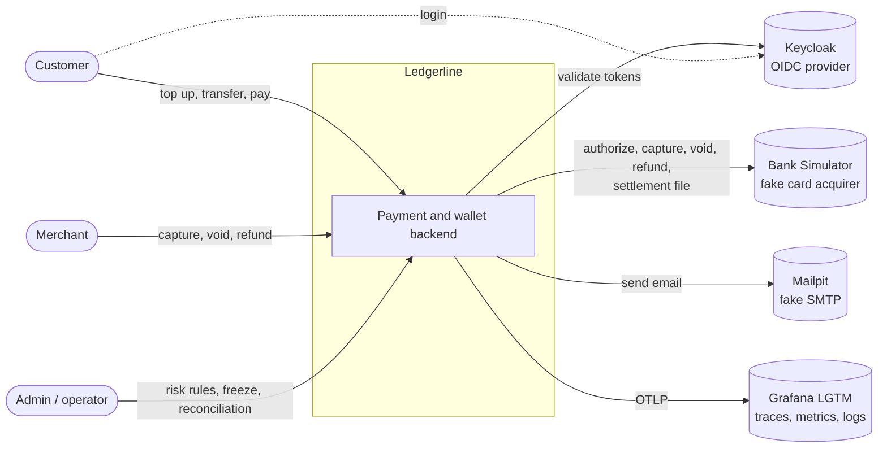
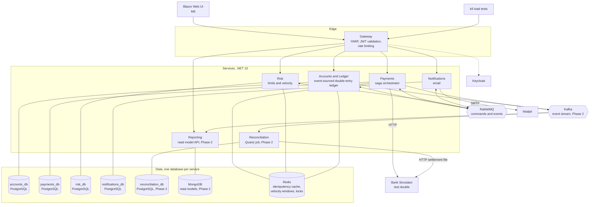
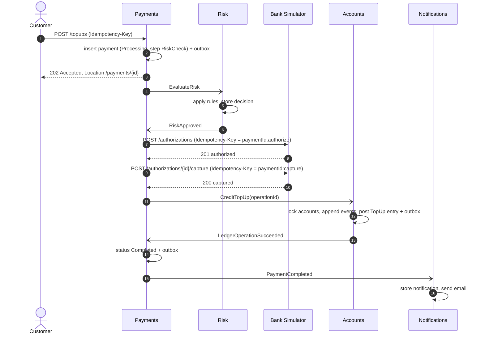
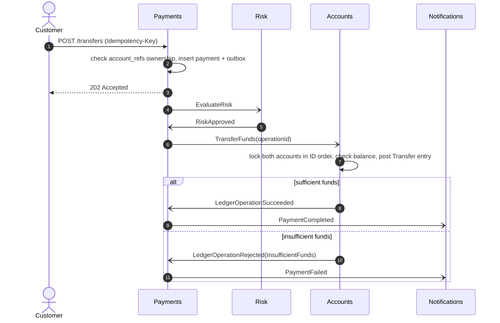
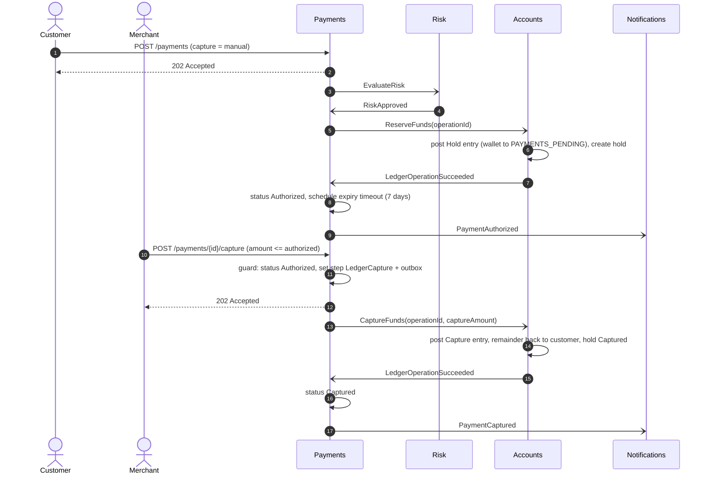
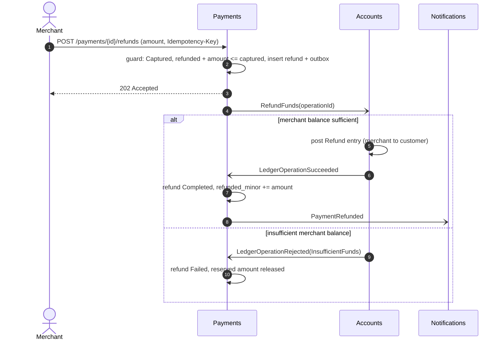
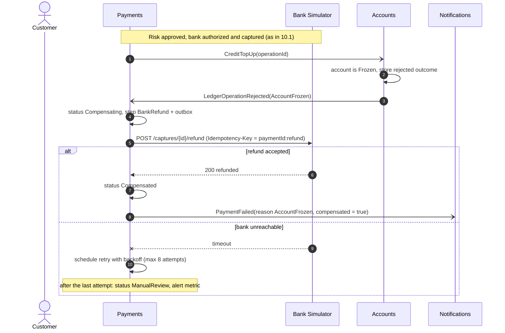

# Ledgerline: Design

Status: design baseline, 2026-11-13. Implementation has not started. See `docs/plan.md`.

Ledgerline is a payment and wallet backend built as microservices. It is a public
portfolio project. It demonstrates concepts (idempotency, double-entry bookkeeping,
sagas with compensation, outbox and inbox, reconciliation). It is not a bank, it is not
PCI DSS compliant, it never touches real money, and it is not banking experience.

## 1. Assumptions

These were not specified and are decided here. Change them before M1 starts if any is wrong.

1. **Repository name: `ledgerline`.** Root namespace `Ledgerline`. Name collisions with
   existing companies or trademarks were not checked.
2. **.NET 10 (LTS), not .NET 11.** .NET 11 packages (11.0.0) are already on NuGet as of
   2026-11-13. The project stays on the LTS line; Microsoft packages are pinned to `10.0.x`.
3. **Single currency per account, no FX.** Amounts are `long` minor units plus an
   ISO 4217 code. Cross-currency movements are rejected.
4. **All money movement enters through Payments.** Accounts exposes account management
   and read APIs over HTTP and accepts ledger commands only over messaging.
5. **Asynchronous API.** Money-moving POSTs return `202 Accepted` with a payment resource.
   Clients poll `GET /payments/{id}` (the UI may later use SignalR, out of scope).
6. **The bank is fake.** `BankSimulator` is a test double living in this repo. It
   stands in for a card acquirer: authorize, capture, void, refund, settlement file,
   and fault injection. Card data is an opaque test token, never a card number.
7. **One PostgreSQL instance, one database and login per service** in Compose and in
   kind. Isolation is enforced by credentials. Separate instances would be the
   production choice and are a Helm values change, not a code change.
8. **Risk limits count approved attempts**, not completed payments. A payment that is
   approved by Risk and later fails still counts toward the daily total. Conservative
   and simple; documented as a known simplification.
9. **Email is the only notification channel**, delivered to Mailpit locally. Merchant
   webhooks are a non-goal.
10. **Messaging and the event store are hand-rolled** (owner decision, 2026-11-13), on
    `RabbitMQ.Client` 7 and PostgreSQL. See ADR 0002, 0003, 0007.
11. **Phase 2 and UI projects are not in the walking skeleton.** `Reporting`,
    `Reconciliation`, and `Web` projects are created by their plan tasks.
12. **Local toolchain:** Windows 11, Docker Desktop, .NET SDK 10.0.4xx. kind and Helm
    are not installed yet; M4 starts by installing them.

## 2. Context

The owner is a .NET backend engineer whose production work is a modular monolith in a
closed repository. Job postings ask for evidence of microservices, RabbitMQ, Kafka,
Kubernetes, saga and outbox, CQRS, and MongoDB. This repository exists to show that
evidence in public: running code, failure tests, measurements, and written decisions.

No code, names, or data from any employer project are used. Everything is written from
scratch for this repository.

## 3. Goals and non-goals

### Goals

- Start the whole system with one command.
- Prove by automated tests that no money is lost or double-processed when the broker is
  down, a service crashes mid-flow, or a message is delivered twice.
- Keep the ledger balanced at all times: the sum of all account balances is zero.
- Publish measurements: k6 results and OpenTelemetry traces and dashboards.
- Write down every real decision as an ADR.
- Run on Kubernetes (kind) with Helm and health checks.
- State honestly when this system should be a monolith instead.

### Non-goals

- Real payment provider integration, PCI DSS, KYC, AML, regulatory reporting.
- Multi-currency conversion, fees, interest, chargebacks, payouts to bank accounts.
- Multi-region, multi-tenant, or high availability of infrastructure.
- A production-grade identity setup. Keycloak runs in dev mode with a seeded realm.
- A polished UI. The Blazor app is a thin demo client.

## 4. System context (C4 level 1)

## 5. Containers (C4 level 2)

Rules that the diagram implies and `tests/Ledgerline.ArchitectureTests` enforces:

- A deployable never references another deployable's assembly.
- Services talk to each other only through RabbitMQ (and Kafka in Phase 2). There are no
  synchronous service-to-service HTTP calls. The only outbound HTTP calls are to systems
  outside the boundary: Bank Simulator and Keycloak.
- The gateway and Bank Simulator know nothing about message contracts.

## 6. Service boundaries and reasoning

| Service | Owns | Why it is its own service |
|---|---|---|
| **Accounts and Ledger** | Accounts, the append-only event store, journal entries, balances, holds | The ledger is the source of truth for money. It has the strictest invariants and the simplest possible reason to change: accounting rules. Nothing else may write balances. Keeping it small makes its invariants testable in isolation. |
| **Payments** | Payment intents, saga state, refunds, the conversation with the bank | A payment is a long-running process across the ledger, risk, and an external provider. Its state machine changes for different reasons than the ledger does (new payment kinds, new provider behavior). |
| **Risk** | Rules, decisions, counters | Rules change often and independently, and a rule engine is a natural candidate for a different scaling and release cadence. It is also the clearest example of a service that can be down without losing money: payments wait. |
| **Notifications** | Recipients, notification log, delivery | Pure downstream consumer. Slow or failing email must never slow or fail a payment. |
| **Bank Simulator** | Fake authorizations and settlement data | Outside the system boundary on purpose. It gives the saga a remote call that can time out, fail, or succeed without answering. |
| **Gateway** | Nothing persistent | Single entry point: token validation, rate limiting, correlation IDs, routing. |
| **Reporting** (Phase 2) | MongoDB read models | CQRS read side. Query shapes (statements, merchant totals, payment timelines) differ from write shapes and may be rebuilt from the stream at any time. |
| **Reconciliation** (Phase 2) | Reconciliation runs and mismatches | A batch concern with its own schedule and its own data, comparing three independent views: bank, payments, ledger. |

Boundaries that were considered and rejected:

- **A separate "Wallet" and "Ledger" service.** Balance checks and postings must be one
  local transaction. Splitting them would turn the core invariant into a distributed
  one for no benefit.
- **Transfers handled only inside Accounts.** A wallet to wallet transfer is one local
  ledger transaction and does not need a saga for consistency. It still goes through
  Payments so that risk checks, idempotency, and the payment timeline are uniform. The
  transfer saga has two steps and no compensation, and the design says so honestly.
- **Risk as a library inside Payments.** This is what a monolith would do and it is the
  right default at this size. See `docs/when-monolith.md`.

The honest summary: at this size the system is a modular monolith candidate. It is
built as microservices because demonstrating the distributed patterns is the purpose.
ADR 0001 records that trade.

## 7. Data ownership

| Data | Owner | Others get it by |
|---|---|---|
| Account identity, type, currency, status | Accounts | `AccountOpened`, `AccountStatusChanged` events. Payments keeps a local `account_refs` replica for ownership checks. |
| Ledger events, journal entries, balances, holds | Accounts | `JournalEntryPosted` events, HTTP read API through the gateway |
| Payment intents, saga state, refunds | Payments | `Payment*` events |
| Risk rules, decisions, daily totals | Risk | `RiskApproved`, `RiskRejected` replies |
| Recipient email, notification log | Notifications | Not shared |
| Users, credentials, roles | Keycloak | JWT claims (`sub`, `email`, realm roles) |
| Bank authorizations, settlement data | Bank Simulator | HTTP API |
| Read models (Phase 2) | Reporting | HTTP read API |
| Reconciliation runs and mismatches (Phase 2) | Reconciliation | `ReconciliationCompleted`, `ReconciliationMismatchDetected` events |

No service reads another service's database. PostgreSQL logins enforce it: each login
can connect only to its own database.

## 8. Ledger model

- **Balance convention:** every account has one signed `balance_minor` equal to
  credits minus debits. Wallets are liabilities and must never go below zero. System
  accounts may be negative.
- **System accounts per currency:**
  - `BANK_CLEARING`: money held at the bank. A top-up debits it, so it runs negative
    (a debit balance, an asset).
  - `PAYMENTS_PENDING`: funds reserved for authorized, not yet captured payments.
- **Global invariant:** the sum of `balance_minor` over all accounts of a currency is
  zero. Every journal entry has at least two lines and its debits equal its credits.

| Entry type | Debit | Credit |
|---|---|---|
| `TopUp` | `BANK_CLEARING` | customer wallet |
| `Transfer` | source wallet | destination wallet |
| `Hold` | customer wallet | `PAYMENTS_PENDING` |
| `Capture` | `PAYMENTS_PENDING` (full hold amount) | merchant wallet (captured amount), customer wallet (remainder, if any) |
| `Release` | `PAYMENTS_PENDING` | customer wallet |
| `Refund` | merchant wallet | customer wallet |

Event sourcing applies to the ledger only (ADR 0007). The `events` table is the source
of truth. `accounts`, `journal_entries`, `journal_lines`, and `holds` are projections
written in the same transaction as the events, and a test rebuilds them from the event
stream and compares.

Concurrency: a posting locks the affected `accounts` rows with `SELECT ... FOR UPDATE`
in ascending account ID order, checks balances, appends events with the next version
per stream, and updates projections. A unique `(stream_id, version)` constraint and a
`CHECK` on wallet balances are the last line of defense. Hot system accounts serialize
postings; this is measured in k6 and discussed in ADR 0007.

## 9. Messaging model

Hand-rolled on `RabbitMQ.Client` (ADR 0002, 0003). Summary; the full contract is in
`docs/specs/building-blocks-messaging.md`.

- **Envelope:** `messageId` (UUIDv7), `type`, `occurredAt`, `correlationId`,
  `causationId`, `traceParent`, `payload`. JSON, UTF-8.
- **Type names carry the version:** `accounts.command.reserve-funds.v1`.
- **Topology:** one durable topic exchange per contract owner (`ledgerline.accounts`,
  `ledgerline.payments`, `ledgerline.risk`). One quorum queue per consuming service
  (`payments.inbox`), plus `<queue>.retry` (TTL) and `<queue>.dead`.
- **Outbox:** the message row is written in the same database transaction as the state
  change. A relay publishes with publisher confirms and marks rows processed. Delivery
  is at least once.
- **Inbox:** the consumer inserts `(message_id, consumer)` in the same transaction as
  the handler's state change. A duplicate insert means skip and acknowledge.
- **Business idempotency on top:** ledger commands carry an `operationId`. Accounts
  stores the outcome per `operationId` and replays the same reply if the command comes
  again with a new `messageId` (a saga retry after a timeout).

Guarantee claimed: at-least-once delivery plus idempotent handling gives effectively
once processing. "Exactly once delivery" is never claimed.

## 10. Main flows

All flows start at the gateway, which validates the JWT and forwards. The gateway is
omitted from the diagrams. Every POST carries an `Idempotency-Key` header. "Outbox"
means the message is committed with the state change and published by the relay.

### 10.1 Top-up (card to wallet)

The wallet is credited only after the bank has captured. The system never gives out
money it does not hold.

### 10.2 Transfer (wallet to wallet)

No compensation exists because the only state-changing step is the last one.

### 10.3 Merchant payment with manual capture

A payment captures at most once: the transition `Authorized -> Capturing` is guarded
by an optimistic concurrency check on the payment row, and the hold in Accounts moves
`Active -> Captured` exactly once.

### 10.4 Refund

### 10.5 Compensated failure: top-up captured at the bank, ledger rejects the credit

The account is frozen between the request and the ledger step. The bank has already
taken the money, so the saga compensates by refunding at the bank.

Other compensation paths, specified in `docs/specs/payments.md`:

- Bank authorize succeeds, capture is declined: void the authorization.
- Bank call times out with unknown outcome: query the bank by idempotency key before
  retrying, never assume failure.
- Authorized merchant payment expires or is voided: release the hold.

## 11. Cross-cutting concerns

- **Identity:** Keycloak realm `ledgerline`, roles `customer`, `merchant`, `admin`.
  The gateway and every service validate the JWT (ADR 0004).
- **HTTP idempotency:** `Idempotency-Key` on every POST. Redis is the fast path
  (in-progress marker and cached response), a unique database constraint is the
  guarantee. If Redis is down the system is slower, not wrong.
- **Observability:** OpenTelemetry traces, metrics, and logs over OTLP to Grafana LGTM
  (ADR 0009). Trace context travels through the outbox, so one trace covers HTTP
  request, relay, broker, consumer, and replies.
- **Health:** `/health/live` (process only) and `/health/ready` (database and broker
  reachable). Readiness never depends on another service.
- **Configuration and secrets:** environment variables. Compose uses development
  defaults. Kubernetes uses Secrets created by Helm from values, with a documented
  note that a real deployment would use an external secret store.
- **Migrations:** each service image runs `migrate` as a one-shot command (Compose
  init service, Helm pre-install and pre-upgrade Job). Services do not migrate on
  startup.

## 12. Phase 2 design

- **Kafka event stream.** The outbox gains a `transport` column. Accounts relays
  `JournalEntryPosted` and Payments relays `Payment*` events to Kafka topics
  `ledgerline.ledger.entries.v1` (key: account ID) and `ledgerline.payments.events.v1`
  (key: payment ID), in addition to RabbitMQ. RabbitMQ stays the command and workflow
  bus; Kafka is the replayable history for read models and reconciliation.
- **MongoDB read model (CQRS).** `Reporting` consumes both topics and maintains
  `account_statements`, `merchant_daily_totals`, and `payment_timelines`. Upserts are
  idempotent by event ID. The read model can be dropped and rebuilt from offset zero,
  and a test proves it.
- **End-of-day reconciliation.** `Reconciliation` runs a Quartz job (ADR 0010) at 00:30
  UTC for the previous day. It downloads the bank settlement file, and performs a
  three-way match: bank captures and refunds, Payments records, and ledger entries on
  `BANK_CLEARING`. It also verifies the trial balance is zero. Results are stored and
  published; Payments stamps `reconciled_at`. Bank Simulator can inject a missing or
  altered settlement row so the mismatch path is tested.

Details: `docs/specs/reporting.md` and `docs/specs/reconciliation.md`.

## 13. Risks and open questions

| Risk | Mitigation |
|---|---|
| Hand-rolled messaging has more failure modes than a library and can make failure tests flaky | Small surface, specified in one spec, tested first in isolation with Testcontainers before any service uses it. Deterministic fault injection points instead of sleeps. |
| Hot system accounts (`BANK_CLEARING`, `PAYMENTS_PENDING`) serialize postings | Measure with k6 first. Documented mitigation: shard system accounts by hash. Not built unless the numbers require it. |
| Scope: six deployables plus Phase 2 for one person on weekends | Milestones are ordered so that M1 alone is a presentable repository. |
| Redis 8 license (AGPLv3, RSALv2, SSPLv1) | Used unmodified as a container image. Valkey is a drop-in alternative; noted in ADR 0000. |
| Infrastructure on Kubernetes is dev-grade (plain StatefulSets) | Stated in the README. Operators named as the production path. |
| Keycloak dev mode with an imported realm | Stated as a non-goal. Test users exist only in the dev realm. |

Document map: `docs/specs/` (one per service), `docs/adr/`, `docs/testing.md`,
`docs/plan.md`, `docs/when-monolith.md`.
